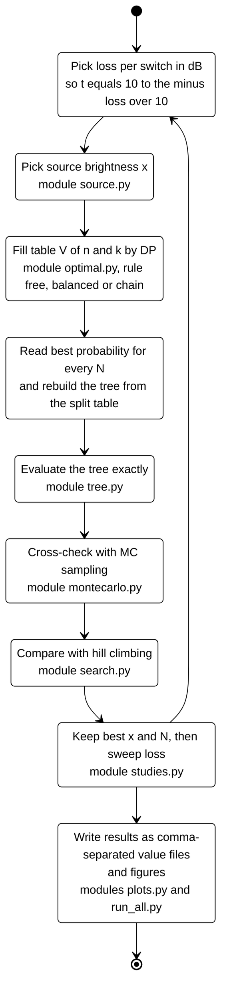
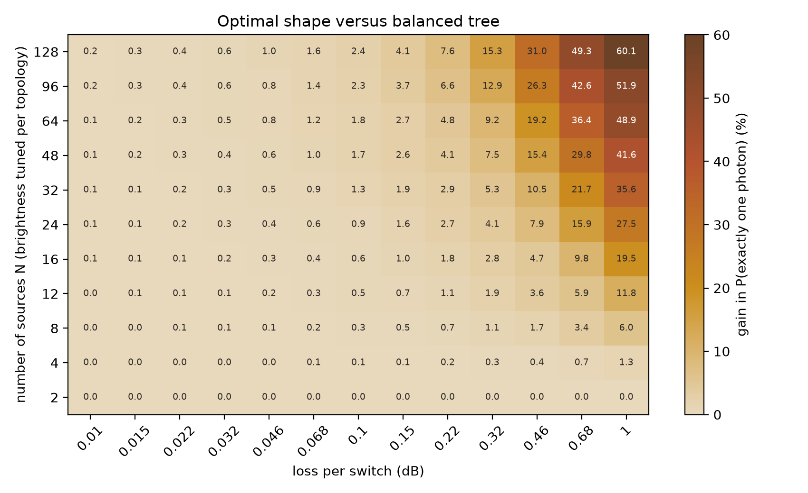
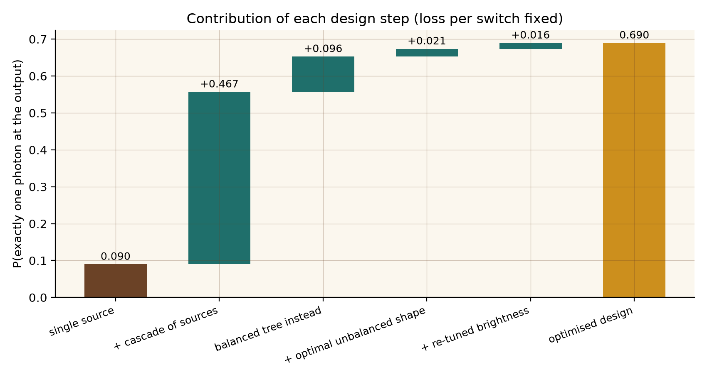
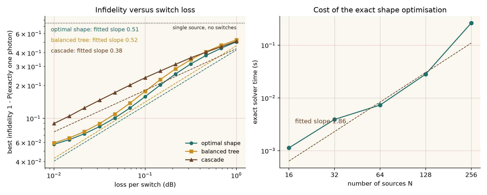
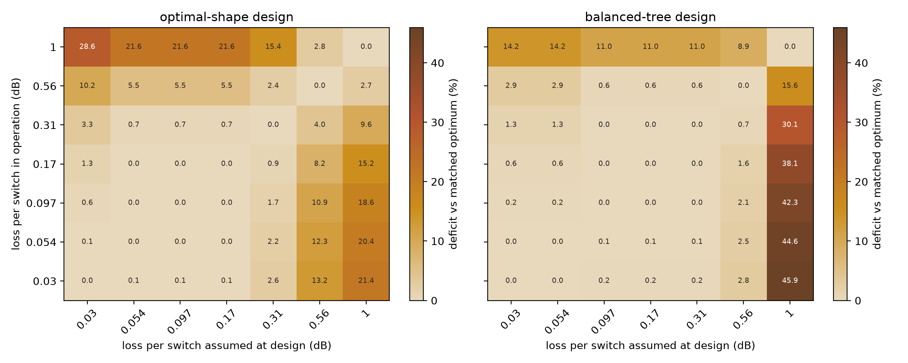
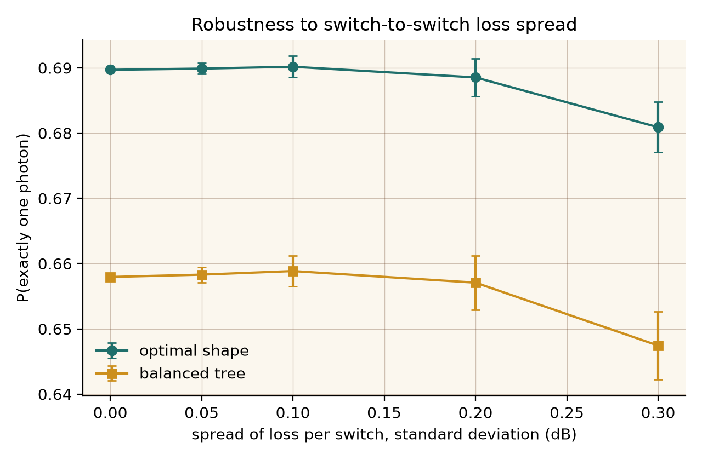

# Loss-Optimal Switch Trees for Photon-Source Multiplexing

[](LICENSE)
[](https://www.python.org/)
[](https://github.com/pradeepdegalaroyal/loss-optimal-switch-tree-photon-multiplexer/actions/workflows/ci.yml)

## Abstract

A photon-source multiplexer routes the output of one of N probabilistic heralded sources through a tree of lossy two-by-two optical switches, and the shape of that tree decides how much loss each photon pays. This study derives an exact dynamic program (DP) that returns the loss-optimal, generally unbalanced tree for thermal pair sources and measures it against balanced-tree, cascade and hill-climbing baselines in exact and Monte Carlo (MC) simulation. At 0.316 dB per switch, the best optimised tree reaches a probability of exactly one output photon of 0.684, against 0.654 for the best balanced tree and 0.640 for the best cascade, and the best infidelity falls roughly as the square root of the per-switch loss; everything is classical simulation on a laptop and no hardware data is used.

## Motivation

Large photonic quantum computers are built from components whose losses are quoted in fractions of a dB: a thin-film lithium niobate (LN) modulator with on-chip loss below 0.5 dB (Wang et al., 2018, digital object identifier (DOI) 10.1038/s41586-018-0551-y), programmable chips approaching 1,000 components (Wang et al., 2020, DOI 10.1038/s41566-019-0532-1), and non-volatile phase-change switching cells compared by settling time and contrast (Nevzorov et al., 2027, DOI 10.1016/j.mssp.2026.111196). An architect needs the next step: given the loss of one switch, how many sources should be multiplexed and how should the switches be wired? Fixed, symmetric wiring is the default. This repository asks whether the loss figure should instead dictate an asymmetric wiring.

## What is new here

- An exact dynamic program over all tree shapes and priority orders for heralded-source multiplexing with thermal multi-photon statistics; the balanced tree and the cascade are special cases of the same program, so the baselines are as strong as they can be.
- A measured scaling law: best infidelity versus per-switch loss, with fitted exponents for three topologies.
- A design-mismatch map showing what happens when the architecture is optimised for one loss value and operated at another, and a loss-spread test.
- A check that a generic shape search with the same objective does not reach the exact optimum at 64 sources.

The cited papers give component losses and system scale; none of them turns a per-switch loss into a wiring rule (see `docs/RESEARCH_GAP.md`).

## Research gap

Wang et al. (2018) and Zhu et al. (2021, DOI 10.1364/AOP.411024) establish low-loss LN switching elements; Wang et al. (2020) and Zhong et al. (2020, DOI 10.1126/science.abe8770) show system scale; Preskill (2018, DOI 10.22331/q-2018-08-06-79) frames noise as the limit on circuit size; Nevzorov et al. (2027) offer non-volatile cells with different settling times. The open piece is architectural: how a per-switch loss maps to the size and shape of a multiplexing network. Four falsifiable hypotheses (H1 to H4) were fixed before the main run; the regime was picked after a pilot that only checked the solver. The outcomes are in the discussion below.

## Method

The diagram shows the algorithm for one design point. Legend: DP is dynamic program, MC is Monte Carlo, N is the number of sources, x is source brightness, t is the power transmission of one switch.



**Model.** Each source has thermal pair statistics P(n) = (1 - x) x^n and a threshold herald detector. A switch forwards its left input if that subtree holds a heralded source, otherwise its right input; every switch has transmission t, so a source at depth d is attenuated by t^d. The target is P1, the probability that exactly one photon leaves. The recursion V(n, k) = max over a of [V(a, k+1) + (1 - x)^a V(n-a, k+1)] is exact, and one table gives the optimum for every n up to N. Full details are in `docs/METHOD.md`.

**Baselines.** (i) Balanced tree and cascade with optimised priorities, the standard design conventions; (ii) hill climbing over shapes with 3,000 evaluations as a generic classical optimiser; (iii) a single source with tuned brightness.

## Results

All numbers below are copied from `results/`. Seeds: 5 (MC, hill climbing, loss spread); exact calculations are deterministic.

**Validation.** At N = 16, 0.3 dB, x = 0.1, the exact P1 of the optimal tree is 0.5847 and the MC value is 0.5846 ± 0.0010 (mean ± standard deviation over 5 seeds of 200,000 shots); balanced: 0.5841 versus 0.5837 ± 0.0012; cascade: 0.5221 versus 0.5220 ± 0.0013 (`results/montecarlo_validation.csv`).

| Loss per switch | Single source | Cascade | Balanced tree | Optimal shape |
|---|---|---|---|---|
| 0.01 dB | 0.248 | 0.910 | 0.941 | 0.942 |
| 0.316 dB | 0.248 | 0.640 | 0.654 | 0.684 |
| 1.0 dB | 0.248 | 0.489 | 0.474 | 0.496 |

Best P1 over N up to 128 and over brightness (`results/loss_scaling.csv`). At 0.316 dB the best sizes are 37 (optimal shape), 23 (balanced) and 22 (cascade) sources; the optimal shape uses brightness x = 0.156.

### Claim 1: the loss-optimal shape beats the balanced tree, and the gain grows with loss and size



*Takeaway: at 32 sources and 0.316 dB the optimal shape gains 5.3 percent in P1 over the balanced tree (H1 asked for at least 3 percent at 0.3 dB); the gain is 0.1 percent at 0.01 dB and 60.1 percent at 128 sources and 1 dB.* Source: `results/gain_vs_balanced.csv`.



*Takeaway: at 0.3 dB and 32 sources, going from one source to a cascade adds 0.467 to P1; replacing it by a balanced tree adds 0.096, the optimal shape 0.021 and re-tuned brightness 0.016, ending at 0.690.* Source: `results/waterfall.csv`. The resulting tree has leaf depths from 3 to 10 and purity (P1 divided by the probability of at least one photon) of 0.876. Caveats: the first steps use brightness x = 0.1 fixed; the cascade-to-balanced step is large because the cascade at this size is a poor design, not because balanced trees are special; at small loss and few sources the gain is under 1 percent and the shape hardly matters. At 128 sources and 1 dB the cascade is within 1.3 percent of the optimal shape (`results/gain_vs_balanced.csv`).

### Claim 2: the best infidelity grows roughly as the square root of the per-switch loss



*Takeaway: fitted log-log slopes are 0.51 (optimal shape), 0.52 (balanced) and 0.38 (cascade); all are well below 1 (H2), and the optimal-shape line sits below the balanced one by a roughly constant factor.* Source: `results/loss_scaling.csv`, `results/summary.json`. Caveats: this is an empirical fit over 0.01 to 1 dB, not a derivation. Below 0.1 dB the best size is 117 or more sources, close to the cap of 128, so the low-loss end is cap-limited. The right panel shows the solver time for N from 16 to 256 with a fitted slope of 1.86; timings are noisy because the laptop was in use (an earlier run of the same code gave other values) and the arithmetic is O(N^3), so only the order of magnitude is meaningful (`results/dp_runtime.csv`).

### Claim 3: a wrong loss assumption costs more than switch-to-switch spread, and the optimal shape is not uniformly safer



*Takeaway: for 32 sources, the optimal-shape design operated at a different loss than it was designed for stays at least as good as a matched balanced design in 73.5 percent of the 49 design/operation pairs (H4), with a worst deficit of 28.6 percent against 45.9 percent for the balanced design.* Source: `results/loss_mismatch.csv`. Caveat: the design includes the brightness, so the deficit mixes shape and brightness mismatch; and the optimal shape is the worse choice when the loss is underestimated (designed for 0.03 dB, operated at 1 dB: deficit 28.6 percent against 14.2 percent for balanced).



*Takeaway: spreading the per-switch loss around 0.3 dB with a standard deviation of 0.3 dB lowers P1 from 0.6897 to 0.6809 ± 0.0039 for the optimal shape and from 0.6580 to 0.6474 ± 0.0052 for the balanced tree, so the ranking survives.* Source: `results/loss_variation.csv` (5 seeds, 100 draws each).

### Baseline search

| N | Exact optimum | Hill climbing (3,000 evaluations) | Relative gap | Hill-climbing time | Exact program time |
|---|---|---|---|---|---|
| 8 | 0.6074 | 0.6074 ± 0.0000 | 0.00 percent | 0.40 s | 0.0005 s |
| 16 | 0.6628 | 0.6619 ± 0.0016 | 0.14 percent | 0.70 s | 0.0020 s |
| 32 | 0.6821 | 0.6771 ± 0.0025 | 0.73 percent | 0.90 s | 0.0027 s |
| 64 | 0.6838 | 0.6615 ± 0.0115 | 3.26 percent | 1.41 s | 0.0085 s |

At 0.316 dB, brightness set to the exact optimum for each N (`results/search_baseline.csv`). The generic search is competitive up to about 16 sources and falls behind as the shape space grows (H3: 3.26 percent at N = 64, above the 1 percent threshold).

## Discussion

All four hypotheses held: H1 (5.3 percent at 32 sources against a 3 percent threshold), H2 (slope 0.51), H3 (3.26 percent gap) and H4 (73.5 percent). The more useful reading is where they hold weakly. Shape optimisation is a second-order effect compared with multiplexing itself (0.467 of the 0.690 in the waterfall) and a first-order one only when per-switch loss is of the order of 0.5 dB or more and the network is large. Below about 0.05 dB the balanced tree is within about 1 percent of the optimum for every size tested (1.0 percent at 128 sources and 0.046 dB). The optimal shape is not a free lunch under model error: it assumes the loss is known, and underestimating it hurts more than for a balanced tree. The square-root-like scaling was measured, not explained; the cascade has a clearly lower exponent (0.38) but a higher floor, which shows that exponent alone is not a quality measure. Multi-photon emission matters: the optimised 32-source design has purity 0.876, so about 12 percent of the events with output light carry more than one photon.

## Limitations

- Idealised switches: no crosstalk, no timing, no finite extinction; delay-line loss is only absorbed into the per-switch figure.
- Herald detectors are perfect threshold detectors with no dark counts or inefficiency; sources are identical and uncorrelated.
- Only left-priority selection with independent switches; no switch sharing or routing constraints.
- The loss-scaling fit is empirical and cap-limited at low loss (N up to 128).
- The balanced tree and cascade are design conventions that are not taken from a cited paper.
- Simulation only; no measured device data, and no claim about any hardware advantage.

## Future work

Add measured switch parameters (for example from LN or phase-change platforms) and a finite-extinction crosstalk term; include herald inefficiency and per-source brightness spread; extend the dynamic program to non-binary (larger-radix) switches and to networks that share switches between several multiplexed outputs; couple the tree to a timing model so that depth carries both loss and latency; and test the loss-mismatch map against a calibrated per-chip loss distribution, which is the natural setting for a lab that characterises its own mesh before recompiling it.

## Reproducibility

```bash
pip install -r requirements.txt
python -m pytest -q                      # 8 fast tests
python experiments/run_all.py --quick    # smoke run, a few seconds, writes results_quick/ and figures_quick/
python experiments/run_all.py            # full study, writes results/ and figures/
```

The full run took about 1 minute on a Windows 11 laptop (16 threads, central processing unit (CPU) only, Python 3.11.9, numpy 2.2.6, pandas 2.3.3, matplotlib 3.11.1); no graphics processor is used. Raw results are comma-separated values (CSV) and one JavaScript Object Notation (JSON) summary in `results/`.

## Project structure

```
src/muxnet/       source.py (photon statistics), tree.py (shapes, exact evaluation),
                  optimal.py (dynamic program), montecarlo.py, search.py (hill climbing),
                  studies.py (experiments), plots.py (figures)
experiments/      run_all.py (one command for everything)
tests/            test_muxnet.py (8 tests, including brute force over all shapes for 6 sources)
docs/             RESEARCH_GAP.md, METHOD.md
results/          CSV tables and summary.json
figures/          fig1 to fig5
.github/workflows/ci.yml   tests and smoke run on every push
```

## Related work by the author

- [photonic-mesh-characterisation-photon-budget](https://github.com/pradeepdegalaroyal/photonic-mesh-characterisation-photon-budget): characterising beamsplitter errors of a Mach-Zehnder interferometer (MZI) mesh at equal photon budget; this project asks the complementary design question for the switches that feed such a mesh.
- [qfc-codesign-heterogeneous-quantum-links](https://github.com/pradeepdegalaroyal/qfc-codesign-heterogeneous-quantum-links): noise-aware co-design of a photonic link with a differentiable model; same habit of optimising a loss budget before building.

## Citation

```bibtex
@software{degala_loss_optimal_switch_tree_2026,
  author  = {Degala, Chenchupradeep},
  title   = {Loss-Optimal Switch Trees for Photon-Source Multiplexing},
  year    = {2026},
  version = {0.1.0},
  url     = {https://github.com/pradeepdegalaroyal/loss-optimal-switch-tree-photon-multiplexer},
  license = {MIT}
}
```

MIT license (`LICENSE`). Citation metadata is also in `CITATION.cff`.
